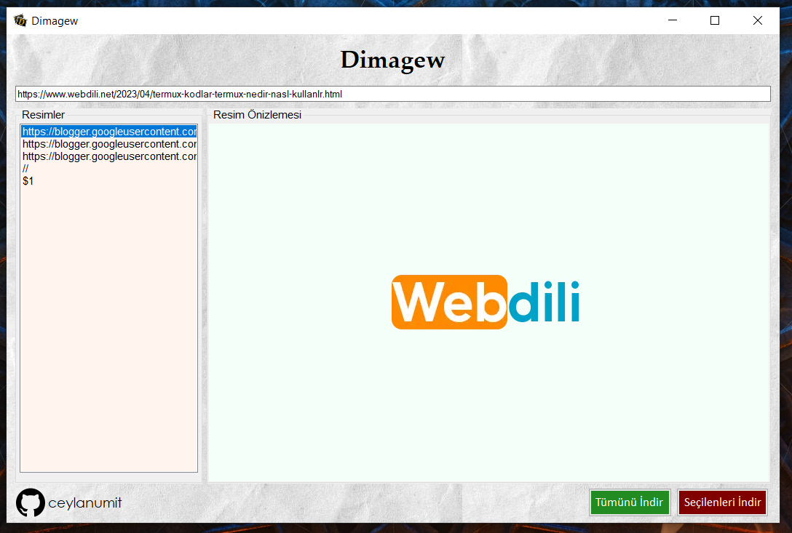

# Dimagew — Web Image Downloader

A C# Windows Forms application for finding image links in a web page, previewing images and downloading selected images or the full list.

## Features

- Extract image URLs from HTML image tags.
- Preview a selected image.
- Save selected images or all discovered images to the Windows Pictures folder.

## Build and run

1. Clone or download this repository.
2. Open `Dimagew/Dimagew.sln` in Visual Studio with the **.NET desktop development** workload and the **.NET Framework 4.7.2 targeting pack**.
3. Restore NuGet packages, including SkiaSharp.
4. Build the solution and run it with **F5**.

## Usage

Enter a complete web page URL, select an image from the results to preview it, then use the selected-image or download-all button. The existing application interface is in Turkish.

## Screenshot

## Scope

This is a desktop learning project. It reads static HTML and does not execute JavaScript. Relative image URLs are not resolved by the current implementation.
